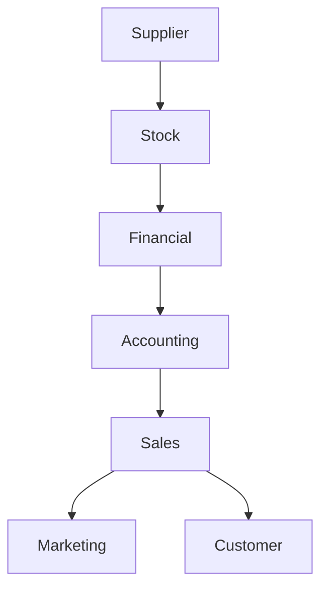

# Ubiq Agentic 2Flow

**2Flow** is a declarative DSL for describing agentic workflows independently of an execution framework. It models agents, tasks, directed graphs, conditional routing, loops, parallel branches, state, retries and human approval.

The compiler translates the same workflow definition into framework-specific projects for **Google ADK**, **CrewAI**, **LangGraph** and **AutoGen**.

> Status: project scaffold and language design. Generated adapters are being implemented incrementally; check each framework directory for its current coverage.

## Goals

- Define workflow topology once; target multiple runtimes.
- Make control flow explicit and reviewable.
- Keep agent/task configuration separate from orchestration.
- Validate graph references and workflow structure before generation.
- Provide deterministic code generation, examples and tests.

## 2Flow at a glance

```2flow
workflow Research {
  input topic: string
  state report: string = ""

  agent researcher {
    model: "openai:gpt-4.1"
    role: "Research analyst"
    goal: "Collect reliable information about the topic"
    tools: [web_search]
  }

  agent writer {
    model: "openai:gpt-4.1"
    role: "Technical writer"
    goal: "Produce a concise evidence-based report"
  }

  task research = researcher("Research {topic}")
  task write = writer("Write report from {research}")

  research -> write
  write -> END
}
```

## Business operations graph: Supplier to Marketing and Customer

The workflow runs the first five departments sequentially. After **Sales**, execution forks into two independent branches: **Marketing** and **Customer**. Both branches can run in parallel.



The same topology in 2Flow:

```2flow
workflow BusinessOperations {
  node Supplier
  node Stock
  node Financial
  node Accounting
  node Sales
  node Marketing
  node Customer

  Supplier -> Stock
  Stock -> Financial
  Financial -> Accounting
  Accounting -> Sales
  Sales -> [Marketing, Customer]
}
```

`A -> [B, C]` is a parallel fan-out: B and C become eligible after A and do not depend on each other. This example intentionally has no join because the requested flow ends at the two parallel branches.

[Open the complete example](./examples/supplier-to-marketing-customer.2flow).

## Control flow

```2flow
workflow Review {
  agent draft
  agent critic
  agent revise

  draft -> critic
  critic -[score < 0.8]-> revise
  revise -> critic
  critic -[score >= 0.8]-> END
}
```

- `A -> B`: directed transition.
- `A -> [B, C]`: parallel fan-out to B and C.
- `-[condition]->`: conditional edge.
- Cycles represent loops; define an exit condition to avoid unbounded execution.
- `END` marks terminal execution.
- State and input declarations are workflow-scoped.

## Compiler architecture

1. Parse `.2flow` into an AST.
2. Validate names, references, edge conditions and graph reachability.
3. Normalize to a framework-neutral intermediate representation (IR).
4. Generate framework files and runtime configuration.
5. Run target-specific tests and examples.

## Frameworks

- [Google ADK](./adk/README.md) — agents, tools, sequential/parallel/loop workflows.
- [CrewAI](./crewai/README.md) — crews, agents, tasks and process orchestration.
- [LangGraph](./langgraph/README.md) — state graphs, nodes, edges, conditional routing and cycles.
- [AutoGen](./autogen/README.md) — agents, teams, handoffs and termination conditions.

## Intended CLI

```sh
# Validate a workflow
ubiq2flow check examples/research.2flow

# Generate one target
ubiq2flow generate examples/research.2flow --target langgraph --out generated/langgraph

# Generate all adapters
ubiq2flow generate examples/research.2flow --target all --out generated
```

## Development

The implementation language, package layout and CLI are established by the source code as they evolve. Generated code should be tested against pinned framework versions in CI; adapter support must be reported honestly rather than silently approximated.

## Contributing

Implement parser and IR behavior first, then adapters and conformance tests. Every syntax feature should have a parser test, validation test and at least one generated-runtime integration example.
